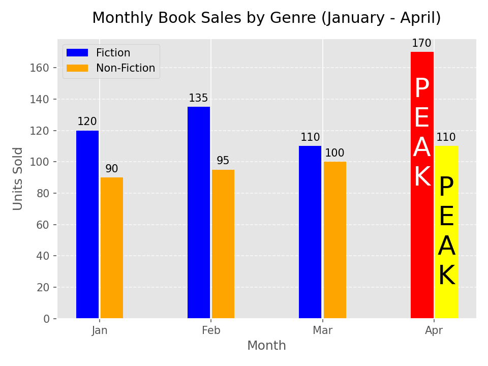
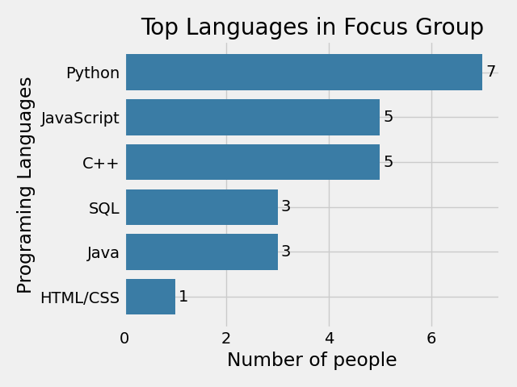
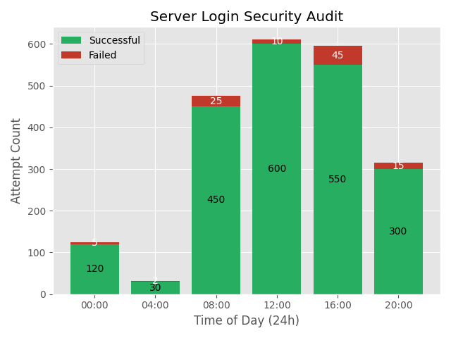
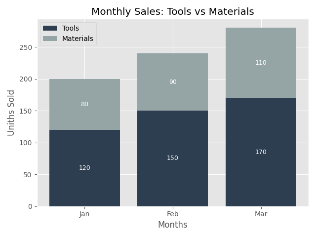
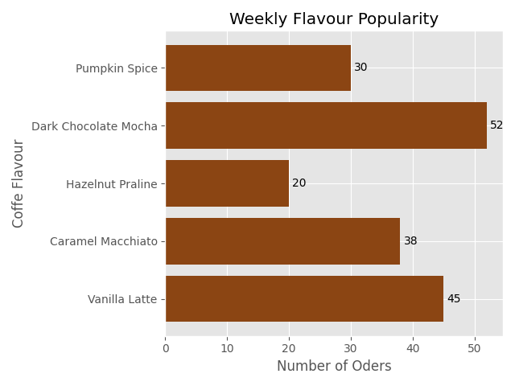

# 📊 Python Data Visualization Portfolio

A collection of data analysis and visualization scripts built with Python, **Matplotlib**, and **Pandas**. This repository demonstrates advanced data parsing, cleaning, and charting techniques including stacked bars, grouped bars, dual subplots, and horizontal layouts.

---

## 📈 Projects Directory

### 1. Gym Attendance (3-Layer Stacked Bar Chart)
Parses a CSV of gym attendance and manually stacks three layers (Cardio, Strength, Yoga) using the `bottom` parameter in Matplotlib.

📂 **Source Code:** [`gym_attendance/`](./gym_attendance)

---

### 2. NGO Financial Summary (Dual Subplots)
Visualizes donations and expenses side-by-side using subplots, complete with rolling average lines and target markers.

📂 **Source Code:** [`book_sales_grouped/`](./book_sales_grouped)



---

### 3. Developer Language Popularity (Horizontal Bar Chart)
Parses semicolon-separated CSV strings using `collections.Counter` and visualizes the most popular programming languages using `barh`.

📂 **Source Code:** [`language_popularity/`](./language_popularity)



---

### 4. Server Login Security Audit (Pandas Stacked Bar)
Demonstrates the transition from the native `csv` module to **Pandas** for faster data manipulation, visualizing successful vs. failed login attempts.

📂 **Source Code:** [`security_audit/`](./security_audit)



---

### 5. Logistics Fuel Expense Report (Pandas Data Cleaning)
Uses Pandas to strip whitespace from CSV headers, calculate a new `Total_Cost` column on the fly, and plot a horizontal bar chart with Euro symbols.

📂 **Source Code:** [`fuel_expense/`](./fuel_expense)


---

### 6. Monthly Sales: Tools vs Materials (Stacked Bar)
A two-layer stacked bar chart using the `ggplot` style to compare two product categories over time.

📂 **Source Code:** [`store_stacked/`](./store_stacked)



---

### 7. Coffee Shop Barh
A horizontal bar chart to visualize coffee flavor popularity.

📂 **Source Code:** [`coffee_barh/`](./coffee_barh)



---

## 🛠️ Setup & Installation

1. **Clone the repository:**
   ```bash
   git clone https://github.com
   cd Data-Visualization
   ```

2. **Install dependencies:**
   ```bash
   pip install matplotlib pandas
   ```

3. **Run a script:**
   ```bash
   cd gym_attendance
   python 12.py
   ```

---

## 👨‍💻 Author

**Tharana Nimsara** — [@Tharana-Dev](https://github.com)
* 🌐 **Portfolio:** [tharana-dev.vercel.app](https://vercel.app)
